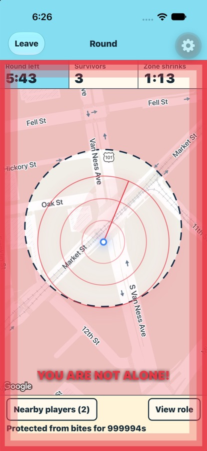
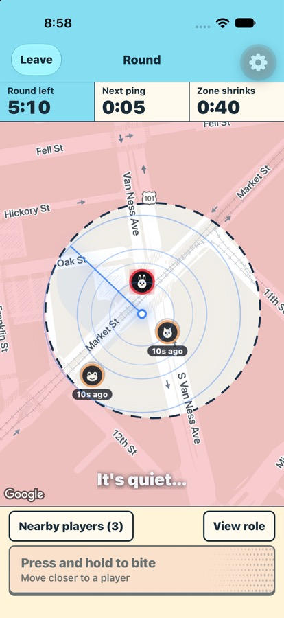
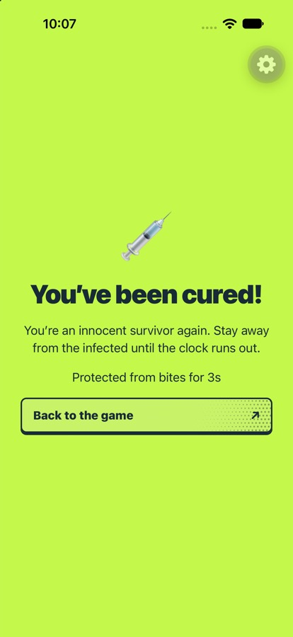
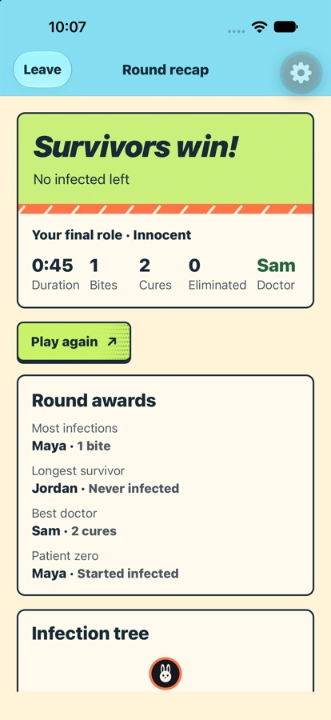
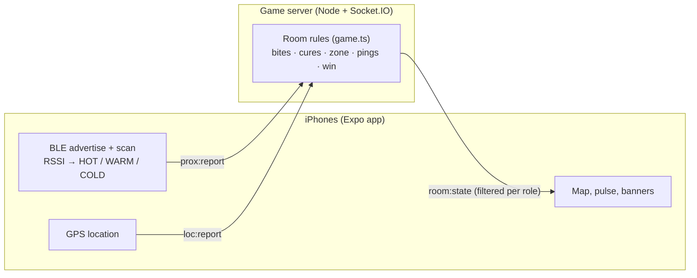

# PULSE

**Real-world zombie tag with your friends. Your phone stays in your pocket and beats like a heart when danger gets close.**

<p align="center">
  
  
  
  
</p>

> Built at **CodeJam 16**, People First track.

---

## Why

Figuring out what to do with friends usually ends at a restaurant, and most other activities cost money. But remember playing tag or manhunt as kids? It was free, and it was the most fun we ever had.

PULSE brings that back for a Friday night: everyone runs around in the real world with secret roles, and nobody has to stare at a screen. Your phone stays in your pocket and buzzes like a heartbeat when someone infected is near.

---

## How to play

1. **Host or join** a room with a 4-letter code. Pick a name and a profile icon.
2. **Spread out.** A short countdown gives everyone time to scatter before roles unlock.
3. **Get a secret role:**

| Role | Goal |
| --- | --- |
| 🧟 **Infected** | Bite survivors. You win if **everyone** is infected, or if you infect **the doctor**. |
| 🙂 **Innocent** | Stay alive until the timer runs out. |
| 💉 **Doctor** | Cure infected players. You have **2 cures**, and a cure only works within **60 seconds** of someone's infection; after that it's permanent. You're not immune: if you get bitten, the infected win. |

**Survivors win** if the timer runs out with survivors left, or if every infected player is cured.

- Rounds last **6 to 8 minutes** (the host picks).
- A **GPS safe zone** shrinks every few minutes and pulls everyone together. Stay outside too long and you're out. Playing indoors? Turn the zone off for **house-party mode**.
- Bites and cures happen face to face: hold the button while you're right next to the player.

---

## Features

- **Heartbeat danger pulse.** Survivors feel how close the nearest infected player is, never who. The screen edge pulses red and the phone vibrates in four steps, from a soft slow tap at the edge of range to a full vibration on every beat when they're right next to you.
- **Bluetooth proximity.** Phones advertise and scan for each other and turn signal strength into HOT / WARM / COLD, smoothed so a single noisy reading doesn't count.
- **A different map per role.**
  - Innocents and the doctor see **nobody** on their map, only themselves, the zone and infection markers.
  - Infected see fellow infected **live**, and survivors only as **delayed, blurred pings** (20–40 m off) with their icon and age, like "30s ago". The server does the blurring, so exact positions never reach a phone.
- **Infection alerts.** An anonymous banner ("Someone was infected · 2 infected · 3 survivors left"), a fading 🧟 marker near where it happened, and a lock-screen notification if the app is in the background.
- **Bitten? Keep playing.** You stay on the map, which switches straight to the infected view. Cured? A full-screen green "You've been cured!".
- **Locked-phone play.** Location and Bluetooth keep running in the background.
- **Profile icons.** 40 original black-and-white creature heads, a different one for everyone in the room. Infected see survivors' icons on the pings.
- **Round recap.** The winner, awards (most infections, longest survivor, best doctor, patient zero) and an **infection tree** of who bit whom.
- **Demo tools** for testing and stage demos, only in rooms with demo players so real games stay fair:
  - **+ Add 3 demo players:** simulated players who walk around near you on fake GPS and play by the real rules.
  - **Test my role:** start as Innocent, Doctor or Infected, and switch mid-round.
  - **Story mode:** a scripted, timed demo. As innocent: a zombie walks up, bites you at 20 s, the doctor cures you at 40 s, survivors win at 50 s. As doctor: a zombie walks up at 10 s and waits for your cure.

---

## Tech stack

| Part | Built with |
| --- | --- |
| **App** (`app/`) | Expo SDK 58, React Native, Expo Router, TypeScript |
| **Bluetooth** | `react-native-ble-plx` for scanning, plus a custom Swift Expo module (`app/modules/ble-advertiser`) for advertising |
| **Maps & location** | `react-native-maps` with Google Maps, `expo-location` (including background) |
| **Feedback** | `expo-haptics`, `expo-notifications` |
| **Server** (`server/`) | Node.js, TypeScript, Socket.IO, hosted on Render |
| **Shared** (`shared/`) | `protocol.ts`, one typed contract for every message between phone and server |
| **Tests** | 65 rule tests (`node:test` + `tsx`) covering roles, bites, the cure window, visibility, pings, the zone, demo players and Story mode |

### Architecture



**The server is the referee.** Phones only report what their Bluetooth hears and where they are. The server decides bites, cures, the cure window, danger levels, pings, the safe zone and the winner, and sends each player only what their role is allowed to see. More in [docs/ARCHITECTURE.md](docs/ARCHITECTURE.md), and the full spec is in [docs/PRD.md](docs/PRD.md).

### Repo structure

```
app/        Expo app: screens in src/app, game UI in src/rooms, Bluetooth in src/bluetooth
server/     Socket.IO game server: rules in src/game.ts, tests in test/
shared/     protocol.ts, shared by app and server
scripts/    make-icons.mjs draws the profile icons
docs/       PRD, architecture notes, screenshots
```

---

## Getting started

You need **Node.js 20+**, a **Mac with Xcode**, and an **iPhone**. Bluetooth doesn't work in the simulator, but demo players do.

### 1. Server

```sh
cd server
npm install
npm run dev        # starts on port 3001 and restarts on changes
npm test           # 65 rule tests
```

Set `DEBUG_TOOLS=0` to turn off the debug panel tools on a public server.

### 2. App

```sh
cd app
npm install
```

Create `app/.env.local` (never commit it):

```sh
EXPO_PUBLIC_SERVER_URL=http://<your-computer-ip>:3001   # or your deployed server URL
GOOGLE_MAPS_IOS_API_KEY=<your-google-maps-ios-key>
```

Build and install on a plugged-in iPhone:

```sh
npx expo prebuild
npx expo run:ios --device --configuration Release
```

For development with live reload, use `npx expo run:ios --device` once, then `npx expo start`.

**Using a free Apple ID?**
- In Xcode, sign in with your Apple ID and pick your Personal Team for the PULSE target.
- On the iPhone, turn on **Settings → Privacy & Security → Developer Mode** and restart.
- The first launch says "Untrusted Developer": go to **Settings → General → VPN & Device Management**, tap your Apple ID and choose **Trust**.
- Free-account builds expire after 7 days; run the build again to refresh.

The phone and your computer must be on the **same Wi-Fi** when the app talks to a local server.

### Round map setup

The iPhone round uses Google Maps SDK for iOS. Set `GOOGLE_MAPS_IOS_API_KEY` in the Expo build environment or in `app/.env.local` for local development. Enable Maps SDK for iOS in the Google Cloud project and restrict the key to the bundle ID `com.babynhi.pulse`. Rebuild the iPhone app after setting or changing this key. [Google's iOS setup guide](https://developers.google.com/maps/documentation/ios-sdk/get-api-key)

The web preview uses a separate `EXPO_PUBLIC_GOOGLE_MAPS_WEB_API_KEY` for the Maps JavaScript API. Restrict it to the web origins that serve PULSE, including localhost for local testing. Restart Expo or rebuild the web export after setting it. [Google's web setup guide](https://developers.google.com/maps/documentation/javascript/get-api-key)

### Deploying the server

We host the server on Render as a web service. A setup that works: root directory `server`, build command `npm install`, start command `npx tsx src/index.ts`, with `PORT` set by Render. Point `EXPO_PUBLIC_SERVER_URL` at the service URL and rebuild the app.

---

## Known limits

- **iOS background Bluetooth is slower.** With the phone locked, iOS scans less often, so proximity updates are slower and less precise than with the app open.
- **Bluetooth signal strength isn't distance.** Bodies, pockets and walls change it, so proximity is three buckets (HOT / WARM / COLD), not meters.
- **GPS indoors is rough.** Use house-party mode (zone off) inside.
- **The free Render plan sleeps.** After about 15 idle minutes the first connection takes up to a minute while the app shows "Waking up the server…". Open the app a minute before playing.
- **iPhone only** for now.

---

## Team

- **Cindy** ([@babynhi](https://github.com/babynhi)): backend, game server and Bluetooth
- **Steven**: mobile app and UI

Made with ❤️ at CodeJam 16.
